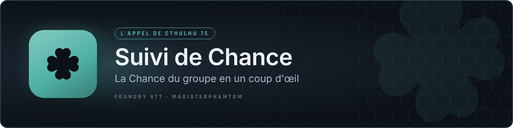

<p align="center"></p>

# CoC7 – Suivi de Chance du groupe

Petit module pour Foundry VTT (V13/V14) + système **CoC7**.

## Ce qu'il fait

Ajoute un bouton (icône trèfle 🍀) dans la barre de contrôles à gauche de
l'écran, dans le groupe **Jeton** (l'icône avec les outils de sélection de
jetons). Un clic ouvre/ferme une petite fenêtre qui liste tous les
personnages joueurs avec leur valeur de **Chance** actuelle, et met en
évidence en doré la (ou les) valeur(s) la(les) plus basse(s) du groupe —
celle utilisée par défaut pour les jets de Chance collectifs.

La fenêtre se rafraîchit **automatiquement** dès qu'une fiche de personnage
est modifiée (Chance dépensée, récupérée, etc.), pas besoin de la rouvrir.

Par défaut le bouton n'est visible que pour le MJ (`game.user.isGM`).

### Séparation par époque (1933 / 2025-2026)

Chaque ligne a un petit menu déroulant **Époque** à droite. Choisis
manuellement pour chaque investigateur :

- **1933 – Expédition Starkweather-Moore**
- **2025-2026 – Descendants**
- **Non assigné** (valeur par défaut tant que tu n'as rien choisi)

Les personnages sont automatiquement regroupés dans des sections
séparées, chacune avec sa propre valeur "la plus basse" — pratique
puisque les deux castings ne jouent jamais dans la même scène. Le choix
est mémorisé sur la fiche du personnage (un flag), donc il n'y a rien à
refaire d'une session à l'autre.

## Installation

**Depuis Foundry (recommandé une fois publié) :** dans le Package Browser,
onglet **Modules**, colle l'URL de manifeste suivante puis clique
**Installer** :

```
https://github.com/magisterphamtom/coc7-luck-tracker/releases/latest/download/module.json
```

**Manuellement :**

1. Décompressez le dossier `coc7-luck-tracker` dans le répertoire des
   modules de votre installation Foundry :
   `[DonnéesFoundry]/Data/modules/coc7-luck-tracker`
2. Lancez Foundry, ouvrez votre monde **Par-Delà les Montagnes
   Hallucinées**.
3. Dans **Configuration du monde → Gérer les modules**, cochez
   **CoC7 – Suivi de Chance du groupe**, puis sauvegardez.
4. Le bouton trèfle apparaît dans le groupe d'outils "Jeton" de la barre
   de contrôles, à gauche du canevas.

## Si la valeur de Chance ne s'affiche pas (« — »)

Le module va chercher la valeur dans `system.attribs.lck.value` (c'est
l'emplacement standard du système CoC7 officiel). Si votre version du
système range la Chance ailleurs, ouvrez la console du navigateur (F12)
et tapez :

```js
game.actors.contents.find(a => a.type === "character").system
```

Repérez le chemin exact vers la valeur de Chance dans l'objet affiché, puis
signalez-le : il suffit d'ajouter ce chemin dans la liste `candidates` de
la fonction `getLuckValue` (fichier `scripts/luck-tracker.js`).

## Personnalisation rapide

- **Rendre le bouton visible aux joueurs aussi** : dans
  `scripts/luck-tracker.js`, repérez la ligne `visible: game.user.isGM,`
  et remplacez-la par `visible: true,`.
- **Couleur de mise en évidence** : modifiez `.coc7-luck-lowest` dans
  `styles/luck-tracker.css`.

## Publier une nouvelle version (release)

Le dépôt contient un workflow GitHub Actions (`.github/workflows/release.yml`)
qui construit et publie automatiquement `module.zip` à chaque tag de
version :

1. Mets à jour le numéro `"version"` dans `module.json` (ex. `1.1.0`).
2. Commit, puis :
   ```
   git tag v1.1.0
   git push origin v1.1.0
   ```
3. Le workflow crée une Release GitHub avec `module.zip` et `module.json`
   attachés — les URLs `manifest`/`download` du module.json restent
   stables et pointent toujours vers la dernière version.

Le tag (`v1.1.0`) et la version dans `module.json` (`1.1.0`) doivent
correspondre exactement, sinon le workflow échoue volontairement pour
éviter une release incohérente.

## Licence

[MIT](LICENSE) — libre de réutilisation, modification et redistribution,
avec attribution.

## Nouveautés 1.1.0
- Choix de l'époque affichée en haut de la fenêtre : **1933**, **2025-2026** ou **Les deux**. Le choix est partagé avec les fenêtres Santé Mentale et Bonds et mémorisé pour chaque utilisateur. Les investigateurs sans époque restent toujours visibles.
